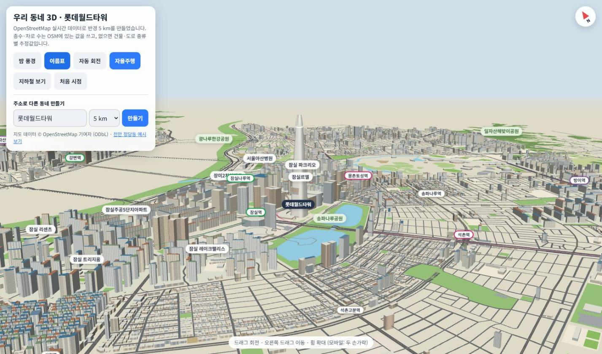
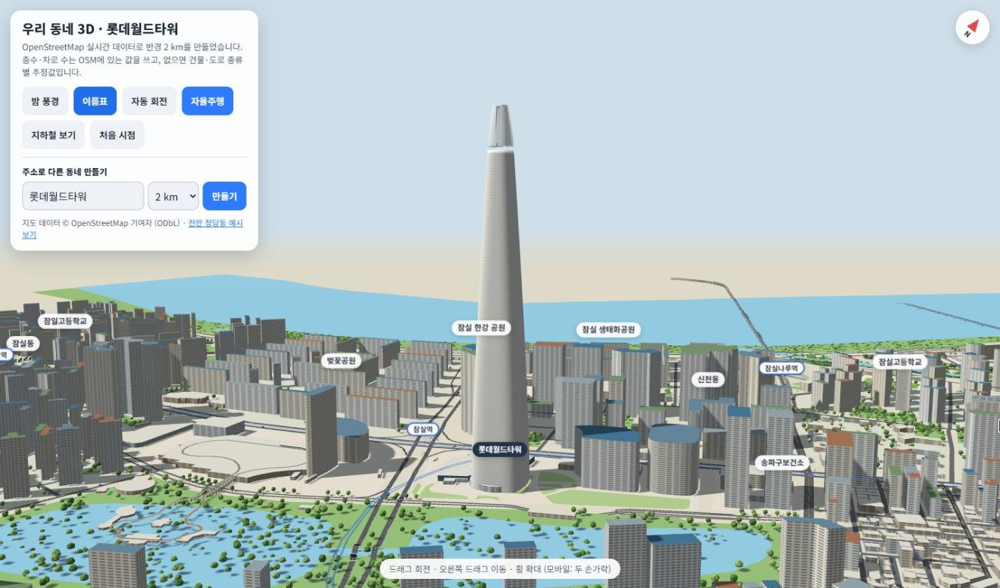
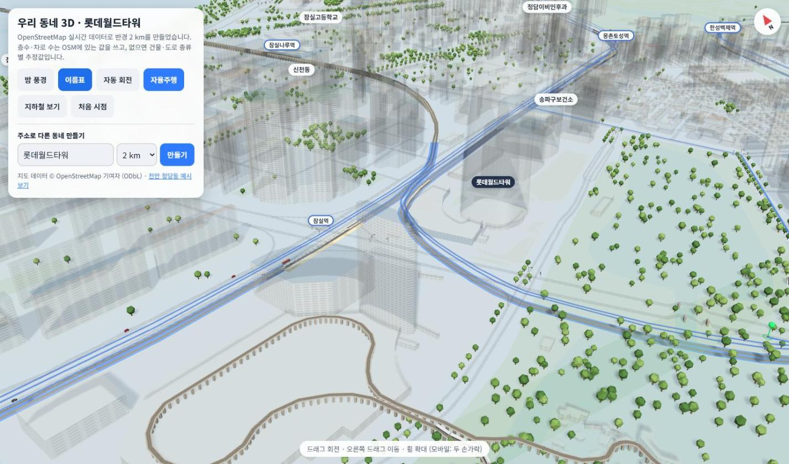
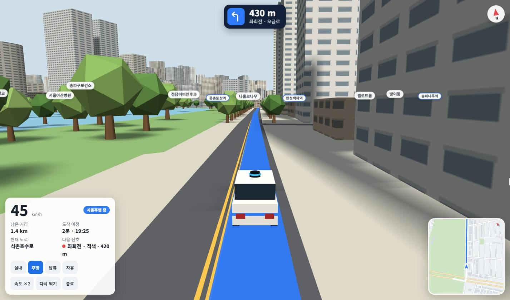
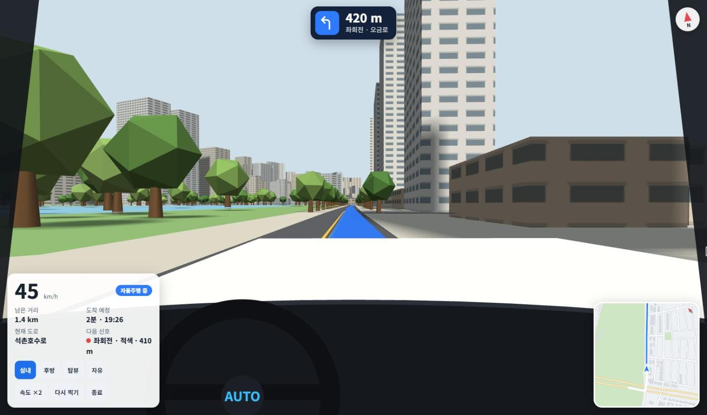
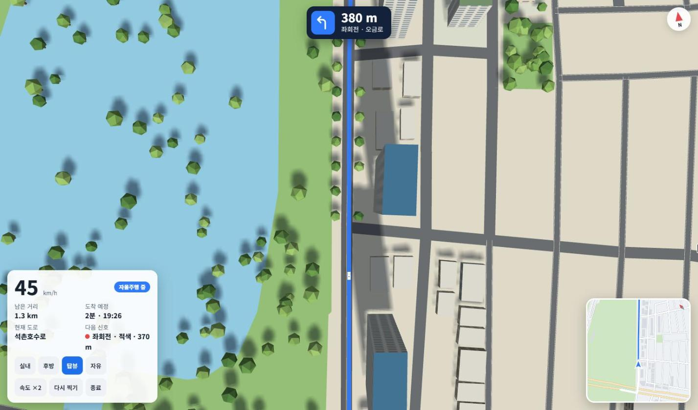
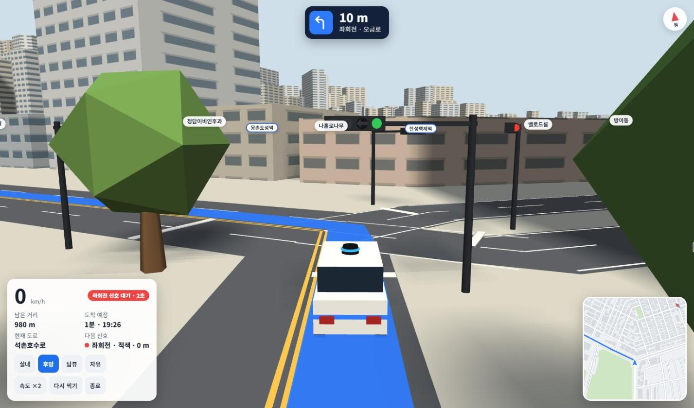
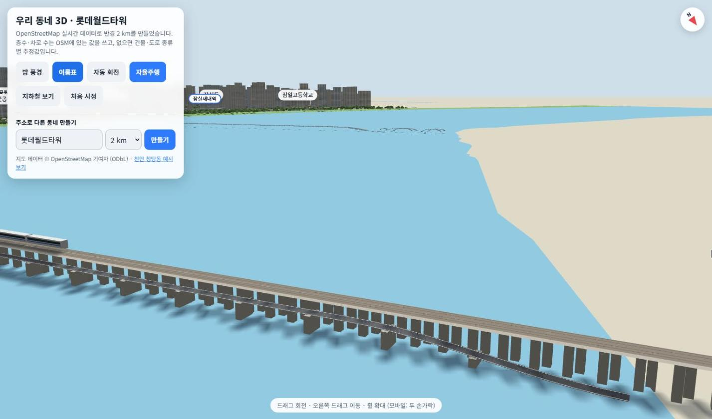
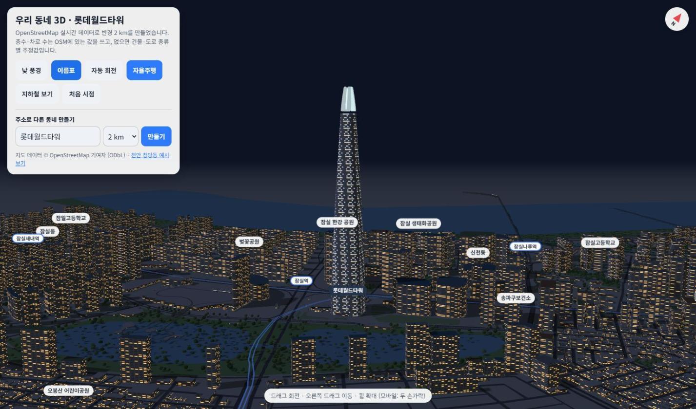

# 우리 동네 3D · OSM Real Buildings 3D Town

**한국어** · [English](#english)

주소 하나로 실제 지도 데이터를 3D 도시로 만들고, 그 안에서 **자율주행·내비게이션·신호 대기·지하철**까지 보여 주는 브라우저 앱입니다.
설치 없이 `index.html` 하나로 돌아가며(Three.js), 주소를 넣으면 **반경 2 · 5 · 10 · 15 · 20 km**를 바로 만듭니다.
기본 화면은 **서울 송파구 롯데월드타워 반경 5 km**입니다.

- 데모(웹 버전): https://muzbox1973.github.io/osm-real-buildings-3d-town/
- 롯데월드타워 2 km(신호등·차선까지 자세히): https://muzbox1973.github.io/osm-real-buildings-3d-town/?addr=롯데월드타워&r=2



---

## 무엇을 할 수 있나요

| 기능 | 설명 |
|---|---|
| 실측 건물 | OpenStreetMap(OSM)의 건물 외곽선을 그대로 세웁니다. 잠실 일대 아파트 단지, 롯데월드몰 같은 대형 건물 모양이 실제와 같습니다. |
| 높이 | **건축물대장 지상층수·높이**(브이월드 GIS건물통합정보, 키가 있을 때) → OSM `height`·`building:levels` → 건물 종류별 기본값 순으로 씁니다. **아파트는 층수 정보가 없으면 15층**으로 세웁니다. 건물 종류가 '아파트'로 표시되지 않았어도 아파트 단지 안의 동, 동 번호 이름(101동 등), 판상형 동 모양이면 아파트로 판별합니다. |
| 랜드마크 | **롯데월드타워**는 실제 형상(높이 554.5 m, 모서리가 둥근 사각 단면이 위로 갈수록 가늘어지는 곡면, 한쪽 면의 세로 이음매, 꼭대기 4갈래 유리 랜턴)으로 따로 모델링합니다. 다른 건물도 OSM의 **3D 건물 부품**(`building:part`, `min_height`, `roof:shape` 돔·뾰족 지붕, `building:colour`)이 있으면 그대로 반영합니다. 높이 80 m 이상 통신탑·전망탑(N서울타워 등)도 탑 모양으로 세웁니다. |
| 문화재·전통 건축 | 경복궁·창덕궁·종묘 등 궁궐, 사찰, 한옥마을과 OSM의 역사·전통 건물은 **한옥**으로 세웁니다(기단·붉은 기둥과 창살·단청 띠·처마 끝이 들린 곡선 기와지붕). 근정전·인정전은 월대 위 중층, 경회루는 돌기둥 위 누각, 광화문·숭례문·흥인지문은 홍예문이 있는 석축 위 문루로 만듭니다. |
| 경기장·큰 건물 | 경기장은 바깥벽·관중석·지붕 차양·잔디(큰 경기장은 육상 트랙)로, 실내 경기장·돔은 둥근 지붕으로 만듭니다. 안마당이 있는 큰 건물은 마당을 비워 둡니다. 국회의사당 돔, 63빌딩 금빛 외장, N서울타워도 실제 모습에 맞춥니다. |
| 공원 | 공원·광장의 산책로, 운동장·육상 트랙·놀이터를 따로 칠합니다. |
| 차량 | 차종별 옆모습 윤곽 차체, 유리 캐빈과 필러, 타이어·휠·휠아치, 범퍼·그릴·전조등·후미등·번호판·사이드미러. 멀리서 볼 때는 차량과 열차를 키워 일반 시점에서도 보이게 합니다. |
| 이름표 | 지명(동·마을), 아파트 단지, 역, 문화재·명소, 건물, 공원·자연, 학교·병원·공공을 많이 모아, 화면에서 겹치지 않게 중요한 것부터 보여 줍니다. **종류 ▾** 버튼으로 종류별로 켜고 끌 수 있습니다(브라우저에 저장). |
| 철도·지하철 | 지상 선로(자갈 도상·레일·침목), 고가 선로(교각), 지하 구간을 구분해 그립니다. 노선색(2호선 초록, 8호선 분홍 등)으로 지하 노선을 지면에 표시하고, **열차가 실제 선로를 따라 달립니다**. 역에는 승강장과 노선색 이름표를 붙입니다. |
| 지하철 보기 | 버튼 하나로 지면·도로·건물을 반투명하게 만들어 땅속 지하철 터널, 지하 승강장, 달리는 열차를 봅니다. |
| 도로·차로 | 도로 폭을 차로 수에 맞추고 중앙선(황색 2줄)·차선(백색 점선)·가장자리선을 그립니다. |
| 신호등 | 교차로마다 가로형 **4색 신호등(적·황·녹색 좌회전 화살표·녹)**과 정지선을 세웁니다. 방향별로 직진 녹색 → 좌회전(적색+녹색 화살표) → 황색 순서이고, 주기·시차는 교차로마다 무작위입니다. |
| 자율주행 | 지도를 두 번 클릭(출발·도착)하면 실제 도로망에서 가장 빠른 길을 찾아 달립니다. 일방통행을 지키고, 오른쪽 차로로만 달려 중앙선을 넘지 않습니다. |
| 신호 대기 | 직진은 녹색, 좌회전은 녹색 화살표에만 진행하고, 그 밖에는 정지선 앞에 섭니다(대기 3초 이하). **우회전은 신호와 관계없이 진행**합니다. |
| 내비게이션 | 다음 안내(좌·우회전, 유턴, 지하차도 진입, 도착), 남은 거리, 도착 예정 시각, 현재 도로, 다음 신호, 진행 방향이 위로 오는 미니맵 |
| 시점 | 실내(운전석) · 후방(추적) · 탑뷰(내비게이션식) · 자유 시점 |
| 교통·밤 풍경 | 승용차·SUV·버스·트럭이 차로별로 달리며 신호를 지킵니다. 밤에는 창문·전조등과 롯데월드타워 랜턴에 불이 켜집니다. |

| 롯데월드타워 | 지하철 보기 |
|---|---|
|  |  |
| **후방(추적) 시점** | **실내(운전석) 시점** |
|  |  |
| **탑뷰(내비게이션식)** | **좌회전 신호 대기** |
|  |  |
| **철도·열차** | **밤 풍경** |
|  |  |

---

## 사용법

### 1) 기본 화면: 롯데월드타워 반경 5 km
웹 버전을 주소 없이 열면 **롯데월드타워 반경 5 km**가 바로 열립니다. 이 데이터는 GitHub Actions가 미리 만들어 저장소(`data.js`)에 넣어 두므로 외부 지도 서버 상태와 상관없이 뜹니다.

| 예시 | 주소 |
|---|---|
| 기본 화면 (롯데월드타워 5 km) | https://muzbox1973.github.io/osm-real-buildings-3d-town/ |
| 롯데월드타워 2 km (신호등·차선·침목까지 자세히) | `.../?addr=롯데월드타워&r=2` |
| 롯데월드타워 10 km (서울 동남권, 초고층·철도 포함) | `.../?addr=롯데월드타워&r=10` |
| 다른 동네 | `.../?addr=주소&r=반경(km)` |

- **마우스**: 왼쪽 드래그 회전 · 오른쪽 드래그 이동 · 휠 확대 (모바일은 두 손가락)
- **버튼**: 밤 풍경 · 이름표 · 자동 회전 · 자율주행 · 지하철 보기 · 처음 시점

### 2) 자율주행
1. 파란 **자율주행** 버튼을 누릅니다.
2. 지도에서 **출발점**, 이어서 **도착점**을 클릭합니다(예: 롯데월드타워 앞 → 잠실역 사거리). 클릭한 곳은 가장 가까운 도로에 붙습니다. (`Esc`로 취소)
3. 경로가 파란 선으로 표시되고 차가 출발합니다.
4. 아래 패널에서 **실내 · 후방 · 탑뷰 · 자유** 시점, **속도 ×1/×2/×4**, **다시 찍기**, **종료**를 고릅니다.

### 3) 지하철 보기
**지하철 보기**를 누르면 지면이 반투명해지고 2호선·8호선 같은 지하 노선의 터널, 지하 승강장, 달리는 열차가 보입니다. 다시 누르면(**지상 보기**) 원래대로 돌아옵니다. 지하 노선은 평소에도 노선색 선으로 지면에 표시됩니다.

### 4) 주소로 다른 동네 만들기
카드 아래 **주소로 다른 동네 만들기**에 주소를 넣고 반경을 고른 뒤 **만들기**를 누릅니다.

예) 주소 칸에 `롯데월드타워` 입력 → 반경 `5 km` 선택 → **만들기**
→ `https://muzbox1973.github.io/osm-real-buildings-3d-town/?addr=롯데월드타워&r=5`

| 반경 | 불러오는 범위 | 비고 |
|---|---|---|
| 2 km | 모든 건물·3D 건물 부품, 모든 도로, 녹지, 신호등, 철도(트램 포함) | 그림자·가로수·차선·침목 표시 |
| 5 km | 위와 같음 (2×2 타일로 나눠 받기) | 그림자는 끔 |
| 10 km | 큰 건물 + 높이 60 m·20층 이상 건물 + 3차로급 이상 도로 + 철도 | 신호는 중심 3 km만 |
| 15 km | 위와 같음, 도로는 2차로급(secondary) 이상 | 3×3 타일 |
| 20 km | 위와 같음 | 4×4 타일, 받는 데 몇 분 걸릴 수 있음 |

**데이터를 받는 방식**
1. **벡터 타일(OpenFreeMap)** 과 **Overpass(OSM 원본)** 를 동시에 요청합니다.
2. 타일이 먼저 끝나면(보통 20~40초), Overpass를 8초만 더 기다립니다. 그 안에 오면 더 자세한 Overpass 데이터(실제 차로 수·신호등 위치·노선색)로, 아니면 타일 데이터로 화면을 만듭니다.
3. 타일 서버가 응답하지 않으면 Overpass를 기다립니다(4개 미러에 차례로 요청, 요청마다 90초 제한, 최대 4번 재시도).

타일 데이터에는 차로 수와 신호등 위치가 없어서, 차로 수는 도로 등급별 기본값으로, 신호등은 간선도로끼리 만나는 교차로에 자동으로 세웁니다. 지하철 노선색도 Overpass 데이터가 있을 때만 실제 색으로 칠해집니다.

> **참고**: 기본 화면(롯데월드타워 5 km)은 저장소에 든 `data.js`만으로 열리므로 Claude 아티팩트나 인터넷 없이 파일로 연 경우에도 동작합니다. 다만 이때는 외부 지도 서버에 접속할 수 없어 주소 모드는 쓸 수 없습니다.

### 5) 건축물대장 층수 쓰기 (브이월드 키)
OSM에는 층수가 빠진 건물이 많습니다. 브이월드 **GIS건물통합정보(LT_C_BLDGINFO)** 는 건물 도형마다 건축물대장의 **지상층수·높이**를 담고 있어, 키가 있으면 이 값을 건물마다 맞춰 씁니다. OSM 건물의 중심이 대장 건물 도형 안에 있거나, 대장 건물의 중심이 OSM 건물 안에 있으면 같은 건물로 봅니다. 한 건물에 여러 대장 건물이 겹치면 가장 높은 층수를 씁니다.

1. [브이월드](https://www.vworld.kr)에 가입하고 **오픈API → 인증키 발급**에서 키를 받습니다. 서비스 URL은 `https://muzbox1973.github.io`(또는 직접 올린 주소)로 등록합니다.
2. **기본 화면(롯데월드타워 5 km)에 반영**: 저장소 **Settings → Secrets and variables → Actions**에 `VWORLD_KEY`(인증키)와 `VWORLD_DOMAIN`(등록한 서비스 URL)을 추가한 뒤, **Actions → Bake default map data → Run workflow**를 누릅니다. 다음부터 매달 자동으로 다시 만들 때도 층수가 들어갑니다.
3. **주소 모드에 반영**: 화면 카드의 **건축물대장 층수 쓰기 (브이월드 키)** 를 열고 키를 넣어 **저장**합니다(이 브라우저에만 저장). 반경 5 km 이하에서 동작합니다.

층수가 반영되면 카드 설명에 "층수는 건축물대장(…) N동을 반영했습니다"가 표시됩니다.

---

## 데이터 출처와 정확도

| 항목 | 출처 | 비고 |
|---|---|---|
| 건물·도로·녹지·철도·역 | © OpenStreetMap 기여자, ODbL 1.0 | [OpenFreeMap](https://openfreemap.org) 벡터 타일 또는 Overpass API로 실시간 조회 |
| 노선색 | OSM 노선(route) 관계의 `colour` | 없으면 수도권 노선 이름으로 지정(1~9호선, 신분당선, 경의중앙선, 수인분당선, 공항철도 등) |
| 롯데월드타워 형상 | 공개된 건축 개요(높이 554.5 m, 123층)를 바탕으로 한 근사 모델 | 위치·방향·밑면 크기는 OSM 외곽선 기준 |
| 차로 수 | OSM `lanes`, `lanes:forward/backward` (Overpass) | 타일 데이터이거나 값이 없으면 도로 종류별 기본값 |
| 층수·높이 | 국토교통부 GIS건물통합정보(브이월드 LT_C_BLDGINFO, 건축물대장 속성) | 브이월드 키가 있을 때만, 반경 5 km 이하 |
| 신호등 | OSM `highway=traffic_signals` (Overpass) | 타일 데이터일 때는 간선도로 교차로에 추정 배치 |
| 기본 화면 데이터 | GitHub Actions가 매달·코드 변경 때 다시 만듦 (`tools/bake.mjs`) | Overpass 우선, 실패하면 타일 |
| 주소 검색 | Nominatim (OpenStreetMap) | 이용 정책상 초당 1회 이하 요청 |

**추정값인 부분**
- 건축물대장·OSM 어디에도 높이가 없는 건물의 층수
- 롯데월드타워 이외 건물의 세부 형상(OSM 3D 부품이 없으면 외곽선을 위로 올린 상자)
- 신호 주기, 열차 운행 간격(실제 시간표가 아님, 노선 끝에서 되돌아가는 왕복 운행)
- 타일 데이터로 만든 경우의 차로 수·신호등 위치·지하철 노선색
- 지하 구간 깊이(지하철 약 16 m, 일반 철도 약 12 m로 고정), 도로 터널은 지면을 파내지 않고 도로만 내림

---

## 로컬에서 실행하기

```bash
git clone https://github.com/muzbox1973/osm-real-buildings-3d-town.git
cd osm-real-buildings-3d-town
python -m http.server 8000
# 브라우저에서 http://localhost:8000/  (롯데월드타워 5 km)
#           http://localhost:8000/?addr=롯데월드타워&r=2
```

---

## 파일 구조

```
index.html                 앱 전체 (렌더링·도로망·철도·랜드마크·자율주행·내비게이션·신호·주소 모드·타일 디코더)
data.js                    기본 화면(롯데월드타워 반경 5 km) 데이터 — GitHub Actions가 생성 (window.TOWN3D_BAKED)
tools/bake.mjs             기본 화면 데이터 생성 스크립트 (헤드리스 브라우저로 앱의 ?dump=1 실행)
.github/workflows/bake.yml 매달 1일·index.html 변경 시 기본 화면 데이터 다시 만들기
docs/screenshots/          README 스크린샷
```

주소 모드에서 내부적으로 쓰는 데이터 (좌표는 기준점에서 동쪽 +x, 남쪽 +z 미터)
- `B`: `[유형, 층수, 이름, [x,z,...], 높이m, 최저높이m, 지붕모양, 외벽색, 부품여부, 지붕높이, 지붕색]`
- `H`: `[도로종류, 0|1터널|2교량, OSM차로, 이름, [x,z,...], [정방향차로, 역방향차로], 일방통행]`
- `RLW`: `[철도종류, 0지상|1지하|2고가, 노선색, 이름, [x,z,...]]` · `ST`: `[역 이름, x, z, 종류]` · `TW`: `[x, z, 높이, 이름]`

---

## 기술 구성

- **렌더링**: Three.js r128 (CDN). 건물은 재질별로 하나의 메시로 합쳐 수만 채도 그립니다.
- **랜드마크**: 이름으로 롯데월드타워를 찾아 외곽선의 중심·방향·크기에 맞춰 곡면 단면(초타원)을 높이별로 쌓아(로프트) 만듭니다. OSM `building:part`가 있으면 외곽선 대신 부품을 `min_height`~`height`로 세우고, `roof:shape`(돔·양파·뾰족·모임 지붕)를 지붕 면으로 만듭니다.
- **철도**: 선로 끝점의 연결 관계로 지하↔지상, 지상↔고가 경사 구간을 자동으로 만들고, 같은 노선색의 선로를 이어 긴 노선을 구성해 열차(지하철 6량, 일반 철도 8량, 경전철 2량)를 왕복 운행합니다. 열차는 인스턴스 메시로 한 번에 그립니다.
- **도로망·경로**: OSM 도로를 교차점 기준으로 이어 그래프를 만들고 Dijkstra로 최단 시간 경로를 찾습니다. 차로 수와 차로 폭으로 오른쪽 차로 중심을 계산합니다.
- **신호**: 교차로마다 두 축(A/B)이 직진 녹색 → 좌회전 화살표 → 황색으로 엇갈립니다. 자율주행 차가 정지선에 서면 대기가 3초를 넘지 않도록 그 교차로 신호를 앞당깁니다.
- **주소 모드**: Nominatim으로 좌표를 찾은 뒤, OpenFreeMap 벡터 타일(MVT, 앱에 내장한 작은 디코더로 해석)과 Overpass API를 동시에 받아 먼저 준비되는 쪽(타일 뒤 8초까지는 Overpass 우선)으로 장면을 만듭니다.
- **자동화 훅**: `window.town3d`(카메라·시점·`tick()` 시뮬레이션 진행 등)로 스크린샷·테스트를 자동화할 수 있습니다.

## 알려진 한계
- 롯데월드타워 외 랜드마크는 OSM 3D 부품 데이터 수준만큼만 표현됩니다.
- 열차 시간표·정차, 보행자 신호, 차선 변경은 없습니다.
- 큰 반경(15·20 km)은 받는 데 시간이 걸리고 저사양 기기에서는 느릴 수 있습니다.
- Overpass 공개 서버가 멈추면 타일 데이터로 만들어지므로 차로 수·신호등·노선색이 추정값이 됩니다.

## 출처 표기
- 지도 데이터 © [OpenStreetMap](https://www.openstreetmap.org/copyright) 기여자, [ODbL 1.0](https://opendatacommons.org/licenses/odbl/)
- 3D 엔진: [three.js](https://threejs.org/) (MIT)

---

<a id="english"></a>
## English

**OSM Real Buildings 3D Town** turns real map data into a 3D city you can drive through — with **autonomous driving, turn-by-turn navigation, traffic lights, landmarks and subways**. It is a single `index.html` (Three.js, no build step). Enter any address and pick a radius of **2 · 5 · 10 · 15 · 20 km**. The default view is **Lotte World Tower, Seoul, 5 km radius**.

- Live demo: https://muzbox1973.github.io/osm-real-buildings-3d-town/
- Detailed 2 km view: `?addr=Lotte World Tower&r=2` · wider: `?addr=Lotte World Tower&r=10`
- The default view ships with the repo (`data.js`, rebuilt by GitHub Actions), so it also opens from a local file or inside a Claude artifact; only address mode needs the map servers.

### Features
- **Real footprints** from OpenStreetMap; heights from `height`/`building:levels`, otherwise per-type defaults. Floor counts and heights can come from the Korean building register (V-World GIS building data, LT_C_BLDGINFO): set `VWORLD_KEY`/`VWORLD_DOMAIN` repository secrets for the baked default view, or save a key in the app's "건축물대장 층수 쓰기" panel for address mode (radius ≤ 5 km). Apartments without floor data get 15 floors; blocks inside apartment complexes, block-number names (e.g. "101동") and slab-shaped footprints count as apartments even when not tagged so.
- **Landmarks**: Lotte World Tower is modeled to its real form — 554.5 m, a rounded-square section tapering in a continuous curve, a vertical seam on one face and a four-petal glass lantern on top, lit at night. Other buildings use OSM **Simple 3D Buildings** data when present (`building:part`, `min_height`, `roof:shape` dome/onion/pyramidal, `building:colour`). Towers of 80 m or more (e.g. N Seoul Tower) get a tower model.
- **Railways & subways**: surface track (ballast, rails, sleepers), viaducts on piers and underground sections, with automatic ramps between them. Underground lines are traced on the ground in their line colours (from OSM route relations, or Seoul line names), **trains run along the real tracks**, and stations get platforms and colour-coded labels.
- **Subway view (x-ray)**: makes the ground, roads and buildings translucent to reveal tunnels, underground platforms and moving trains.
- **Lane-accurate roads**: road width follows lane count; yellow double center lines, white dashed lane lines and edge lines.
- **Traffic lights**: Korean 4-lamp heads (red, yellow, green left arrow, green). Each approach runs green (straight) → left arrow → yellow, with randomized cycles and offsets.
- **Autonomous driving**: click a start and a destination; the car routes over the real road graph (Dijkstra, one-way aware), stays in the right-hand lane, goes straight only on green, turns left only on the green arrow (waits capped at 3 s) and turns right without waiting.
- **Navigation HUD** and **camera views** (cockpit, chase, navigation-style top view, free). Night mode with lit windows, headlights and the tower lantern.

### Radius levels
| Radius | Data loaded |
|---|---|
| 2 km | all buildings and building parts, all drivable roads, green areas, traffic signals, all railways incl. trams |
| 5 km | same, fetched as 2×2 tiles (shadows off) |
| 10 km | large buildings + any building ≥ 60 m or ≥ 20 floors + tertiary roads and above + railways |
| 15 / 20 km | same with secondary roads and above, 3×3 / 4×4 tiles |

> Data comes from **OpenFreeMap vector tiles** and the **Overpass API** requested in parallel. When the tiles are done, Overpass gets 8 more seconds; if it answers, its richer data (real lane counts, signal positions, line colours) is used, otherwise the tile data is. With tiles, lane counts default by road class, signals are placed at arterial intersections, and subway lines use a default colour. The default view loads a pre-baked `data.js` generated by GitHub Actions (`tools/bake.mjs`), so it opens even when map servers are down.

### Run locally
```bash
python -m http.server 8000   # then open http://localhost:8000/
```

### Data & accuracy
- Map data © OpenStreetMap contributors (ODbL), served via OpenFreeMap tiles or the Overpass API. Line colours from OSM route relations. Lotte World Tower form is an approximation based on its published specifications; position, orientation and base size come from the OSM footprint.
- Estimated parts: missing heights, detailed shapes of other buildings without OSM 3D parts, signal timings and train headways (random, trains shuttle back and forth), tunnel depths (subway ~16 m, rail ~12 m).

### Known limitations
No train timetables or station stops, no pedestrian phases or lane changes; large radii take time to download and may be slow on low-end devices.
