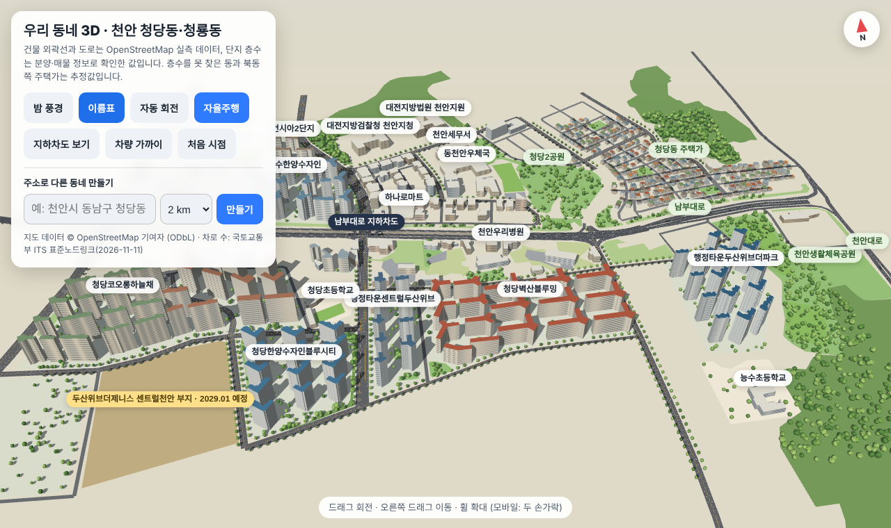
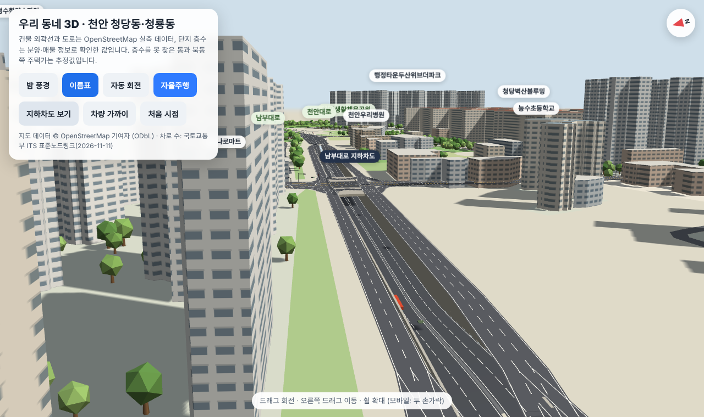
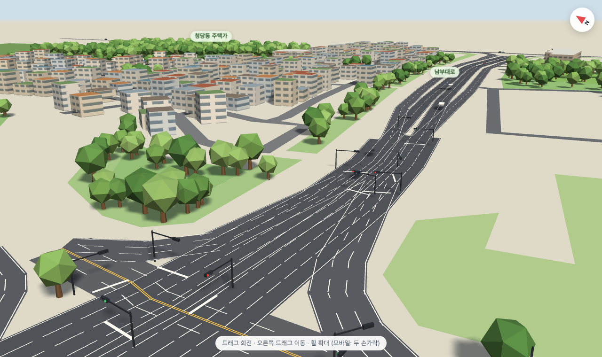
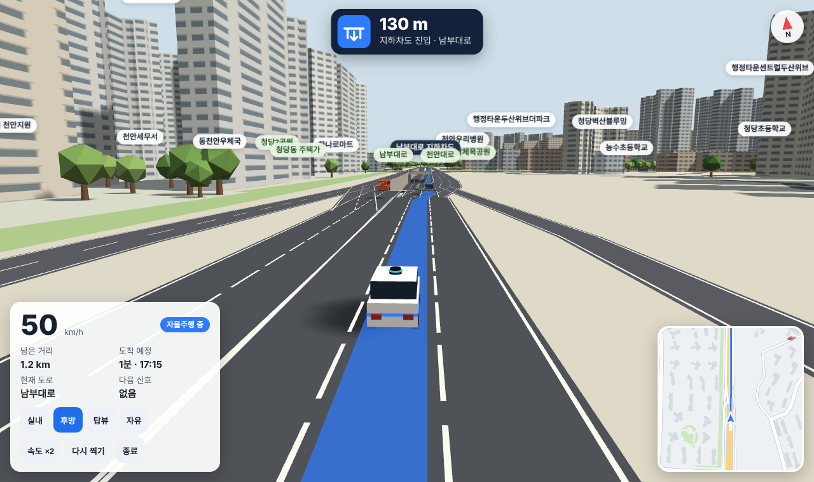
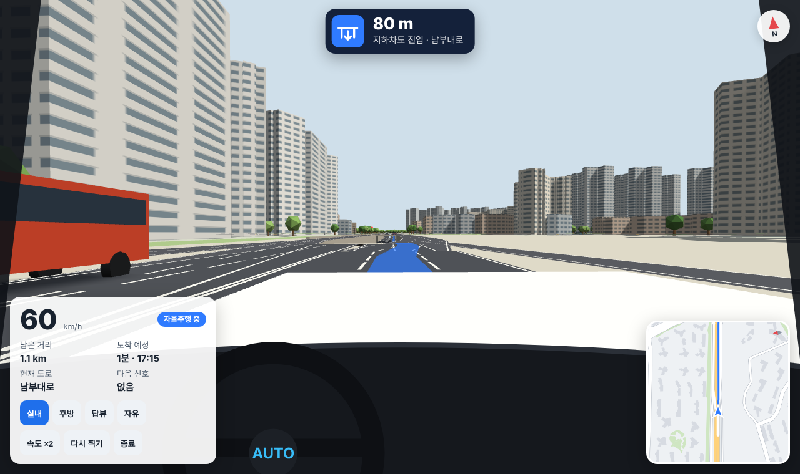
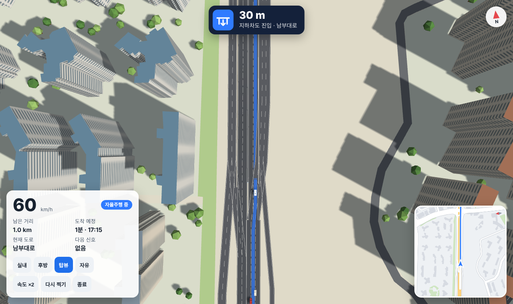
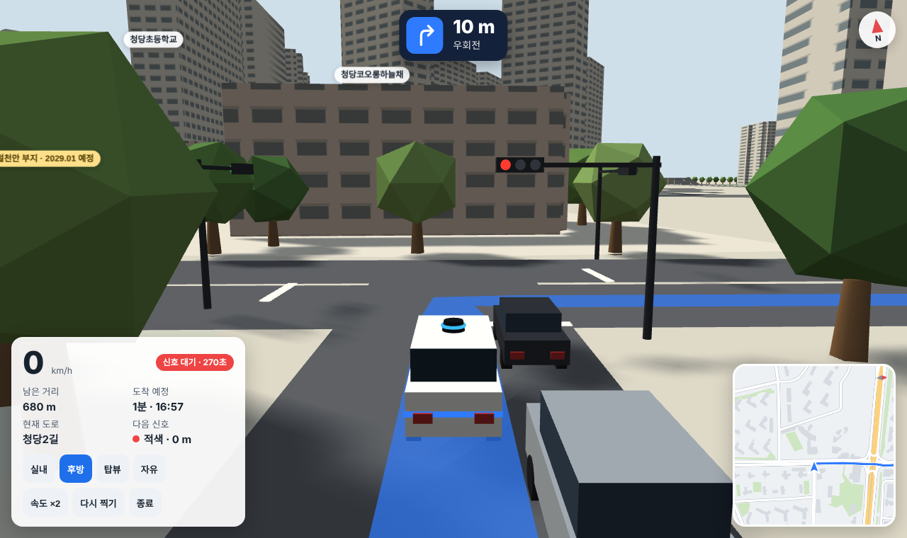
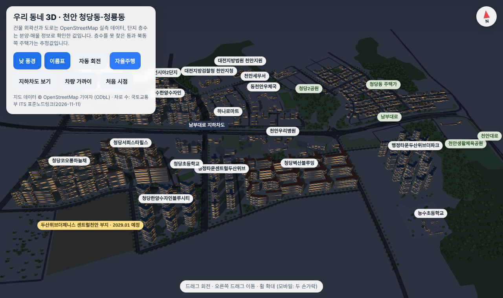

# 우리 동네 3D · OSM Real Buildings 3D Town

**한국어** · [English](#english)

실제 지도 데이터로 동네를 3D로 만들고, 그 안에서 **자율주행·내비게이션·신호 대기**까지 체험하는 브라우저 앱입니다.
설치 없이 `index.html` 하나로 돌아가며(Three.js), 주소만 넣으면 **반경 2 · 5 · 10 · 15 · 20 km** 동네를 바로 만들어 줍니다.

- 데모(웹 버전): https://muzbox1973.github.io/osm-real-buildings-3d-town/
- 주소 모드 예: `https://muzbox1973.github.io/osm-real-buildings-3d-town/?addr=천안시청&r=5`



---

## 무엇을 할 수 있나요

| 기능 | 설명 |
|---|---|
| 실측 건물 | OpenStreetMap(OSM)의 건물 외곽선을 그대로 세웁니다. ㄱ·ㄷ자 판상형, 탑상형 아파트 모양이 실제와 같습니다. |
| 층수 | OSM `building:levels`·`height` 값을 쓰고, 없으면 건물 종류별 기본값을 씁니다. 청당동 예시는 분양 기사·매물 정보로 확인한 층수를 넣었습니다. |
| 도로·차로 | 도로 폭을 차로 수에 맞춰 그리고, 중앙선(황색 2줄)·차선(백색 점선)·가장자리선을 그립니다. |
| 지하차도·고가 | 터널은 지하로, 교량은 위로 올립니다. 청당동 예시의 남부대로 지하차도는 옹벽·덮개까지 만들었습니다. |
| 신호등 | 교차로마다 가로형 3구 신호등과 정지선을 세우고, 교차로마다 주기·시차를 무작위로 줍니다. |
| 자율주행 | 지도를 두 번 클릭(출발·도착)하면 실제 도로망에서 가장 빠른 길을 찾아 달립니다. 일방통행을 지키고, 양방향 도로에서는 오른쪽 차로로만 달려 중앙선을 넘지 않습니다. |
| 신호 대기 | 적색이면 정지선 앞에 서고, 신호 대기는 3초를 넘지 않습니다. 앞차가 서 있으면 거리를 두고 멈춥니다. |
| 내비게이션 | 다음 안내(좌·우회전, 유턴, 지하차도 진입, 도착)와 남은 거리, 도착 예정 시각, 현재 도로, 다음 신호를 보여 줍니다. 진행 방향이 위로 오는 미니맵도 있습니다. |
| 시점 | 실내(운전석) · 후방(추적) · 탑뷰(내비게이션식, 진행 방향 위) · 자유 시점 |
| 교통 | 승용차·SUV·버스·트럭이 차로별로 달리고 신호를 지키며 줄을 섭니다. |
| 밤 풍경 | 창문 불빛과 전조등·후미등이 켜집니다. |
| 주소 모드 | 주소 + 반경(2·5·10·15·20 km)을 고르면 OSM 데이터를 받아 같은 엔진으로 동네를 만듭니다. |

| 지하차도 | 차로·중앙선 |
|---|---|
|  |  |
| **후방(추적) 시점** | **실내(운전석) 시점** |
|  |  |
| **탑뷰(내비게이션식)** | **신호 대기** |
|  |  |
| **밤 풍경** | |
|  | |

---

## 사용법

### 1) 청당동 예시 (기본 화면)
`index.html`을 열면 천안시 동남구 청당동·청룡동 일대가 바로 나옵니다.

- **마우스**: 왼쪽 드래그 회전 · 오른쪽 드래그 이동 · 휠 확대 (모바일은 두 손가락)
- **밤 풍경 / 이름표 / 자동 회전 / 지하차도 보기 / 차량 가까이 / 처음 시점** 버튼

### 2) 자율주행
1. 카드의 파란 **자율주행** 버튼을 누릅니다.
2. 지도에서 **출발점**, 이어서 **도착점**을 클릭합니다. 클릭한 곳은 가장 가까운 도로에 붙습니다. (`Esc`로 취소)
3. 경로가 파란 선으로 표시되고 차가 출발합니다.
4. 아래 패널에서 **실내 · 후방 · 탑뷰 · 자유** 시점, **속도 ×1/×2/×4**, **다시 찍기**, **종료**를 고릅니다.

### 3) 주소로 다른 동네 만들기
카드 아래 **주소로 다른 동네 만들기**에 주소를 넣고 반경을 고른 뒤 **만들기**를 누릅니다.
URL로 바로 열 수도 있습니다: `?addr=주소&r=반경(km)`

| 반경 | 불러오는 범위 | 비고 |
|---|---|---|
| 2 km | 모든 건물, 이면도로까지 모든 도로, 녹지, 신호등 | 그림자·가로수·차선 모두 표시 |
| 5 km | 위와 같음 (2×2 타일로 나눠 받기) | 그림자는 끔 |
| 10 km | 큰 건물(아파트·상업·공업·학교·병원 등) + 3차로급 이상 도로 | 신호는 중심 3 km만 |
| 15 km | 위와 같음, 도로는 2차로급(secondary) 이상 | 3×3 타일 |
| 20 km | 위와 같음 | 4×4 타일, 받는 데 몇 분 걸릴 수 있음 |

> **주의**: Claude 아티팩트 화면에서는 보안 정책 때문에 외부 지도 서버에 접속할 수 없어 주소 모드가 동작하지 않습니다. 이때는 화면에 나오는 링크로 웹 버전(GitHub Pages)이나 로컬 서버에서 여세요.

---

## 데이터 출처와 정확도

| 항목 | 출처 | 비고 |
|---|---|---|
| 건물 외곽선·도로·녹지 | © OpenStreetMap 기여자, ODbL 1.0 (Overpass API) | 청당동 예시는 2026-11-24 조회분을 `data.js`에 저장 |
| 차로 수 (청당동 예시) | 국토교통부 ITS 국가교통정보센터 **전국표준노드링크** (2026-11-11 기준) | 방향별 `LANES`를 OSM 도로에 매칭. 122개 도로 중 98개 매칭 |
| 차로 수 (주소 모드) | OSM `lanes`, `lanes:forward/backward` | 없으면 도로 종류별 기본값 |
| 층수 (청당동 예시) | 분양 기사·부동산 매물 정보 | 벽산블루밍 15층, 서희스타힐스 최고 27층, 코오롱하늘채 23층, 두산위브더파크 최고 26층, 청수한양수자인 22층, 행정타운센트럴두산위브 25층(OSM) 등 |
| 주소 검색 | Nominatim (OpenStreetMap) | 이용 정책상 초당 1회 이하 요청 |

**추정값인 부분**
- 층수를 찾지 못한 단지(예: 휴먼시아2단지, 포레나)와 OSM에 층수가 없는 건물
- 청당동 예시의 북동쪽 단독주택가: OSM에 개별 건물이 없어 골목을 따라 근사 배치
- 신호 주기: 실제 신호 시간이 아니라 교차로마다 무작위
- 주소 모드의 터널: 지면을 파내지 않고 도로만 지하로 내립니다(청당동 예시의 지하차도만 옹벽·덮개까지 표현)

---

## 로컬에서 실행하기

브라우저가 파일을 직접 여는 `file://`에서도 청당동 예시는 동작합니다. 주소 모드까지 쓰려면 간단한 웹 서버로 여는 것을 권장합니다.

```bash
git clone https://github.com/muzbox1973/osm-real-buildings-3d-town.git
cd osm-real-buildings-3d-town
python -m http.server 8000
# 브라우저에서 http://localhost:8000/  또는  http://localhost:8000/?addr=천안시청&r=2
```

### 청당동 차로 수 다시 만들기 (선택)
```bash
pip install pyshp pyproj
# its.go.kr 에서 NODELINKDATA.zip 을 받아 MOCT_LINK.* 를 푼 뒤
python tools/extract_nodelink.py MOCT_LINK 36.7745 127.1430 36.7865 127.1660 36.7805 127.1545 nodelink_cheongdang_lanes.json
python tools/match_lanes.py   # data.js 의 도로에 방향별 차로 수를 기록
```

---

## 파일 구조

```
index.html                 앱 전체 (렌더링·도로망·자율주행·내비게이션·신호·주소 모드)
data.js                    청당동 예시 데이터 (B: 건물, H: 도로, A: 면)
tools/extract_nodelink.py  표준노드링크 shapefile → 범위 추출 JSON
tools/match_lanes.py       표준노드링크 차로 수 → OSM 도로 매칭
docs/screenshots/          README 스크린샷
```

`data.js` 형식 (좌표는 기준점에서 동쪽 +x, 남쪽 +z 미터)
- `B`: `[유형, 층수, 이름, [x,z,...]]` — 유형 `a` 아파트, `c` 상업, `s` 학교, `h` 병원, `y` 기타 …
- `H`: `[도로종류, 0|1터널|2교량, OSM차로, 이름, [x,z,...], [정방향차로, 역방향차로]]` (주소 모드는 7번째에 일방통행 여부)
- `A`: `[면종류, 이름, [x,z,...]]` — park, wood, residential, school, pitch, parking, water …

---

## 기술 구성

- **렌더링**: Three.js r128 (CDN), 건물은 재질별로 하나의 메시로 합쳐 수만 채도 그립니다.
- **도로망**: OSM 도로를 교차점·끝점 기준으로 이어 그래프를 만들고(공간 격자로 가속), 터널·교량과 평면 도로는 서로 잇지 않습니다.
- **경로**: Dijkstra(도로 종류별 제한 속도로 시간 가중), 일방통행 준수, 실패 시 양방향 그래프로 재시도.
- **차로 주행**: 차로 수와 차로 폭(3.0~3.5 m)으로 진행 방향 오른쪽 차로 중심을 계산해 중앙선을 넘지 않게 달립니다.
- **신호**: 교차로마다 두 축(A/B)이 녹색→황색(3초)→적색으로 엇갈립니다. 자율주행 차가 정지선에 서면 대기 시간이 3초를 넘지 않도록 그 교차로의 신호를 앞당깁니다.
- **주소 모드**: Nominatim으로 좌표를 찾고 Overpass API로 반경 안 데이터를 타일 단위로 받아 같은 엔진으로 만듭니다.

## 알려진 한계
- 좌회전 전용 신호, 보행자 신호, 차선 변경은 없습니다.
- 다른 차와의 충돌은 단순한 앞차 따라가기만 합니다.
- 큰 반경(15·20 km)은 데이터 양 때문에 받는 데 시간이 걸리고, 저사양 기기에서는 느릴 수 있습니다.
- Overpass 공개 서버가 붐비면 응답이 늦거나 실패할 수 있습니다(자동으로 다른 서버를 시도).

## 출처 표기
- 지도 데이터 © [OpenStreetMap](https://www.openstreetmap.org/copyright) 기여자, [ODbL 1.0](https://opendatacommons.org/licenses/odbl/)
- 차로 수: 국토교통부 ITS 국가교통정보센터 [전국표준노드링크](https://www.its.go.kr/nodelink/nodelinkRef)
- 3D 엔진: [three.js](https://threejs.org/) (MIT)

---

<a id="english"></a>
## English

**OSM Real Buildings 3D Town** turns real map data into a 3D neighborhood you can drive through — with **autonomous driving, turn-by-turn navigation and traffic lights**. It is a single `index.html` (Three.js, no build step). Enter any address and pick a radius of **2 · 5 · 10 · 15 · 20 km** to generate that area.

- Live demo: https://muzbox1973.github.io/osm-real-buildings-3d-town/
- Address mode: `?addr=<address>&r=<km>` e.g. `?addr=Seoul City Hall&r=5`

### Features
- **Real footprints** from OpenStreetMap; heights from `building:levels`/`height`, otherwise per-type defaults. The bundled Cheongdang-dong (Cheonan, Korea) sample uses floor counts verified from sales notices and listings.
- **Lane-accurate roads**: road width follows lane count; yellow double center lines, white dashed lane lines and edge lines. The sample uses per-direction lane counts from the Korean national standard node-link dataset (ITS, 2026-11-11).
- **Underpasses and bridges**: tunnels go below ground, bridges rise on piers. The sample's Nambu-daero underpass has retaining walls and a covered section.
- **Traffic lights** at intersections with randomized cycles and offsets, stop lines, and queuing traffic (sedans, SUVs, buses, trucks).
- **Autonomous driving**: click a start and a destination; the car routes over the real road graph (Dijkstra, one-way aware), stays in the right-hand lane (never crosses the center line), stops at red lights (waits are capped at 3 seconds) and keeps distance from the car ahead.
- **Navigation HUD**: next maneuver (left/right/U-turn/underpass/arrival), remaining distance, ETA, current road, next signal, heading-up mini map.
- **Camera views**: cockpit, chase, navigation-style top view, free orbit. Night mode with lit windows and headlights.

### Radius levels (address mode)
| Radius | Data loaded |
|---|---|
| 2 km | all buildings, all drivable roads, green areas, traffic signals |
| 5 km | same, fetched as 2×2 tiles (shadows off) |
| 10 km | large buildings (apartments, commercial, industrial, schools, hospitals…) + tertiary and above |
| 15 / 20 km | large buildings + secondary and above, 3×3 / 4×4 tiles |

> Address mode needs network access to Nominatim and Overpass. It does not work inside a Claude artifact (blocked by its content security policy); use the GitHub Pages version or a local web server.

### Run locally
```bash
python -m http.server 8000   # then open http://localhost:8000/
```

### Data & accuracy
- Map data © OpenStreetMap contributors (ODbL). Lane counts for the sample: MOLIT ITS national standard node-link.
- Estimated parts: missing floor counts, the detached-house block in the sample (not mapped in OSM), signal timings (random), tunnels in address mode (road lowered without cutting the ground).

### Known limitations
No dedicated left-turn or pedestrian phases, no lane changes, simple car-following only; large radii take time to download and may be slow on low-end devices.
